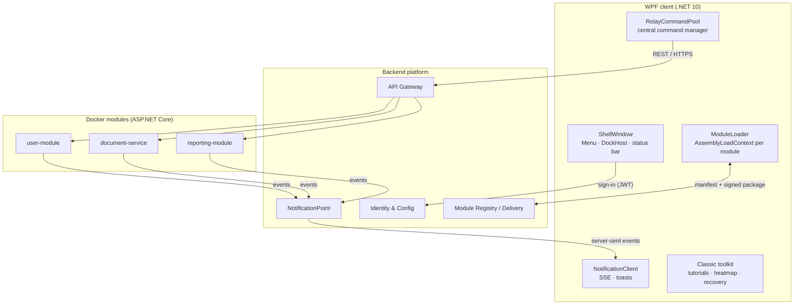
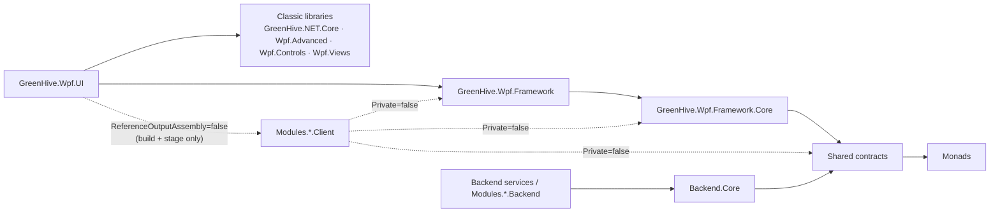
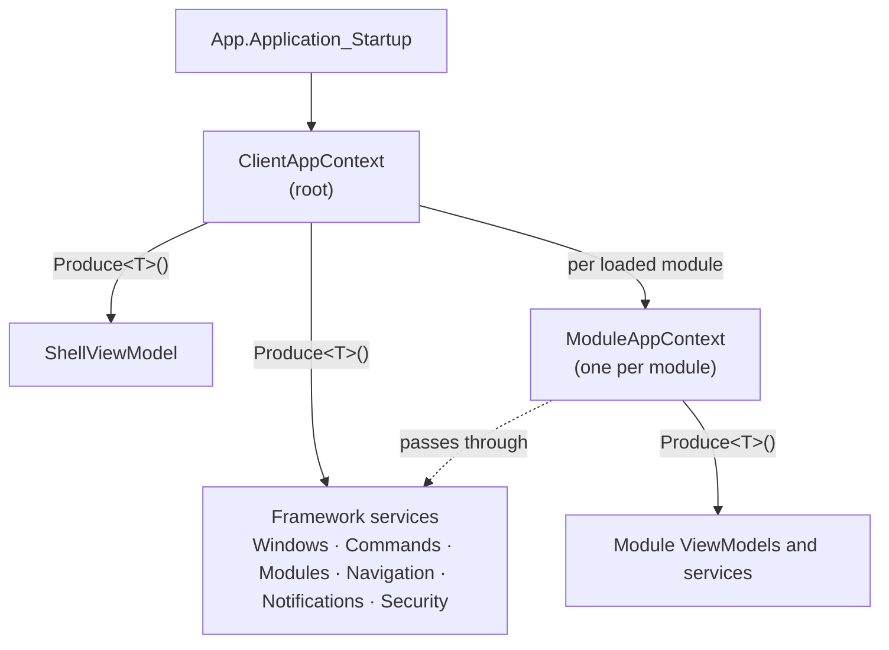
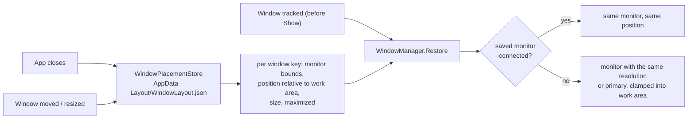
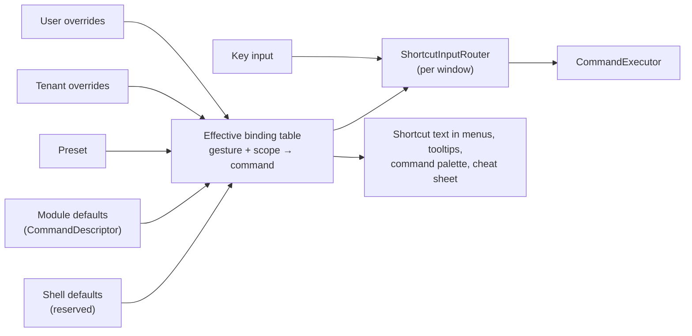
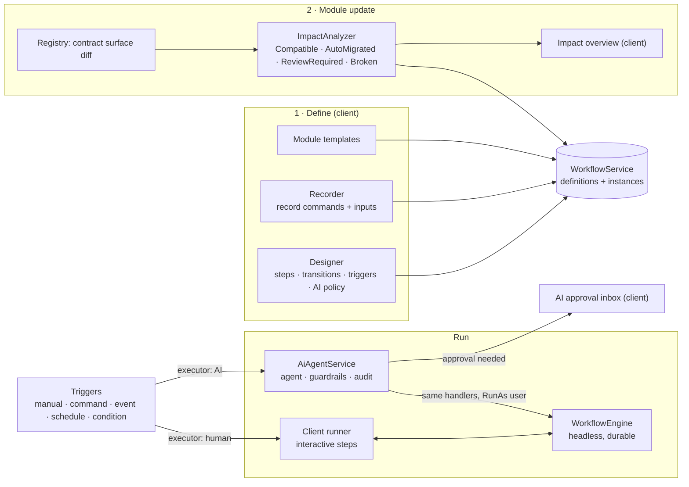
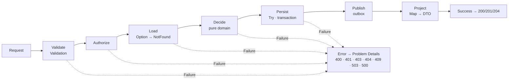

# Green Hive – Architecture

Modular, server-driven WPF framework on **.NET 10 (LTS)**: self-written MVVM on an application context
(AppContext architecture) + central command manager (RelayCommandPool) + hot-swap + NotificationPoint + dynamic module
delivery + Docker microservices + workflows that users design in the app and AI can execute — and the classic
Green Hive toolkit (tutorials, heatmap, crash recovery, telemetry, Fluent styles) running inside the same shell.

> **Status:** implemented end to end – client framework (UI-free core + WPF layer), the WPF host, three modules
> (client + backend), the backend platform, Docker Compose and a PostgreSQL database with demo data.
> How to run it: [README.md](README.md).
>
> | Area | Implemented |
> |---|---|
> | Shared | Monads (`Result`, `Option`, `Validation`, `Error`, `Try`, LINQ/async), wire contracts for platform, modules (manifest, contract surface + diff, compatibility), commands, notifications, workflows (definition, steps, triggers, AI policy, safe expression language, analysis, input validation, impact report) |
> | Client core (UI-free) | Mvvm (ApplicationContext, AppObject, ViewModelAppObject, languages, log, JSON persistence, size classes), Commands (RelayCommandPool, command trees, shortcut manager, executor, dispatcher abstraction), ModuleLoader (catalogue, download + signature check, dependency resolution, own load context per module, module SDK base classes), HotSwap (version notices, quiescence, swap + rollback), Security (`BackendConnection`, permissions, profile, localized errors), NotificationClient (SSE hub with catch-up, router, in-app centre, pluggable WNS), Navigation (registry, service, wheel model, history), Docking model (items, layout state), Workflows (manager, runner, recorder, ViewModels) |
> | Client WPF | Docking (DockManager, DockHost with splitters, auto-hide strips, dock guides, floating windows), Windowing (WindowManager with per-monitor placement, responsive layout), Commands (`gh:Ui.*` attached properties, menu/tree adapters, rich tooltips, keyboard routing), Navigation wheel control + input handler, desktop toasts, DPAPI token store, module SDK controls (UiKit, SpacedPanel, MessageBar, DataList, InputForm, SimpleChart, LooseXaml, Fluent-style compat controls), workflow views (inbox, designer/recorder, impact, AI panel) |
> | Host | `ClientAppContext` as `IModuleHost`, startup sequence, shell window (title area with palette and profile, menu bar, dock layout, status bar, wheel, cheat sheet, tutorial overlay), sign-in dialog, shell commands, built-in views (start, Module Explorer, output, notifications, settings incl. shortcut recording) and the classic GreenHive views as dock views |
> | Modules | DocumentManagement (documents, versions, invoices with submit/approve/reject/pay, home dashboard), Reporting (catalogue, parameter form, chart + table, runs), UserManagement (directory, create/edit, roles, password reset, organization) |
> | Backend | Core + gateway, identity, configuration, module registry, module delivery, update orchestrator, notification point, workflow service (engine, triggers, impact analysis + migration), AI agent service (rules + OpenAI-compatible provider, guardrails, audit) |
> | Deployment | `Deployment/Docker` (compose, schema, demo data and events), `Deployment/ModulePackages/pack-modules.ps1`, `build.cmd` |

## Overview

The system has four areas:

1. **WPF client** – a long-running host app that loads feature modules from the server at runtime.
2. **Central backend platform** – manages modules, users, permissions, updates and notifications.
3. **Docker modules** – independent ASP.NET Core services holding each feature's business logic.
4. **Workflows** – multi-step input flows designed in the app, analysed on every module update and
   executable by people or by an AI agent on triggers.



A feature consists of two artifacts: a **client package** (WPF class library, signed ZIP, loaded at runtime) and a
**backend container**. A client module is never a Docker container itself.

## Solution structure

The solution `GreenHiveFramework.slnx` (repository root) groups the projects into solution folders.

| Folder | Project | Type | Purpose |
| --- | --- | --- | --- |
| `Host/` | `src/GreenHive.Wpf.UI` | WPF app | `ClientAppContext`, startup, shell window, sign-in, profile, built-in and classic views, classic services |
| `Client/` | `GreenHive.Wpf.Framework.Core` | .NET 10 library | UI-free framework: Mvvm, Commands, ModuleLoader (+ SDK base classes), HotSwap, Security, NotificationClient, Navigation, docking model, Workflows |
| | `GreenHive.Wpf.Framework` | WPF library | Docking, Windowing, `gh:Ui` attached properties, menu adapters, keyboard routing, navigation wheel, toasts, DPAPI token store, module SDK controls, workflow views |
| `Client/Classic/` | `GreenHive.NET.Core` (`src/Green Hive`) | WPF library | Classic AppKontext MVVM, RelayCommand(s), connection pool, strategies, storage, updates |
| | `GreenHive.Wpf.Advanced` | WPF library | Composite module handler, notifications, permissions, recovery, snapshots, telemetry, tutorials |
| | `GreenHive.Wpf.Controls` | WPF library | Fluent theme extensions, palette/history windows, heatmap, toasts, performance overlay, tab view |
| | `GreenHive.Wpf.Views` | WPF library | Dashboard, preferences, profile, admin, help views |
| `Shared/` | `GreenHive.NET.Monads` | .NET 10 library | Self-written monads: `Result`, `Option`, `Validation`, `Error`, `Try`, async + LINQ extensions |
| | `GreenHive.NET.Contracts` | .NET 10 library | Base types, error model, platform API records, `TextKey`, `IconRef`, JSON options |
| | `GreenHive.NET.ModuleContracts` | .NET 10 library | Module entry point, context, manifest model, contract surface + diff, compatibility |
| | `GreenHive.NET.CommandContracts` | .NET 10 library | Command IDs, descriptors, placements, tree nodes, gestures, handlers |
| | `GreenHive.NET.NotificationContracts` | .NET 10 library | Notification envelope, event types |
| | `GreenHive.NET.WorkflowContracts` | .NET 10 library | Workflow definitions, steps, input schemas, triggers, instances, impact reports, AI policy, expressions |
| `Backend/` | `GreenHive.NET.Backend.Core` | ASP.NET Core library | Monad architecture for all backends: use-case pipeline steps, `ResultHttpMapper`, exception boundary, outbox, audit, Npgsql |
| | `….ApiGateway` | ASP.NET Core | Single public entry, static + registry-driven routes, rate limiting |
| | `….IdentityService` | ASP.NET Core | Authentication (JWT), roles, permissions, delegated tokens, avatars |
| | `….ModuleRegistryService` | ASP.NET Core | Modules, versions, enablement, compatibility, contract-surface diff |
| | `….ModuleDeliveryService` | ASP.NET Core | Signed package storage and download |
| | `….UpdateOrchestrator` | ASP.NET Core | Staged rollouts, hot-swap vs. restart, rollback, hold on broken workflows |
| | `….NotificationPoint` | ASP.NET Core | Event store with sequence numbers, SSE stream with catch-up, subscribers, WNS |
| | `….ConfigurationService` | ASP.NET Core | Global/tenant/role/user settings, AI model profiles |
| | `….WorkflowService` | ASP.NET Core | Workflow storage, server-side engine, triggers, impact analysis, migrations |
| | `….AiAgentService` | ASP.NET Core | AI execution of workflows: agent, tool catalogue, guardrails, audit log |
| `Modules/<Feature>/` | `GreenHive.NET.Modules.<Feature>.Client` | WPF library | Module entry point, ViewModels, code-only views |
| | `GreenHive.NET.Modules.<Feature>.Backend` | ASP.NET Core | Feature API as Docker container |
| | `manifest.json` | – | Module manifest (client package + backend service + contract surface) |

The earlier experiments `GreenHive.Maui.*`, `GreenHive.Wpf.Core`, `GreenHive.Wpf.Dto` and `GreenHive.Api` (EF in-memory auth API,
replaced by the identity service) remain in `src/` but are not part of the solution.

### Project references



- Module clients reference the framework and contracts with `Private=false`, so they are not copied into the module
  package and are shared through the host's default load context.
- `GreenHive.Wpf.Framework.Core` has no WPF dependency: everything that can run headless (commands, shortcuts, module
  loading, hot-swap, security, workflows) is testable on any OS. The WPF layer only adds controls and input.

## Application context (AppContext architecture)

The MVVM layer is self-written and follows the AppKontext architecture of
[WIFI.Anwendung](https://github.com/zenoxart/WIFI.CS.2021/tree/master/WIFI.Anwendung) – the same architecture the
classic `GreenHive.NET.Core` uses (`AppKontext`, `AppObject`, `Produziere<T>()`), in English for the platform.

| WIFI.Anwendung | Classic Green Hive | Platform | Role |
| --- | --- | --- | --- |
| `IAppKontext` | – | `IAppContext` | "has an application context" |
| `AppKontext` | `AppKontext` | `ApplicationContext` | Infrastructure + object factory `Produce<T>()`, lazy services, paths, UI dispatcher |
| `AppObjekt` | `AppObject` | `AppObject` | Base of all services; `ErrorOccurred` event (rethrown in DEBUG if unhandled) |
| `ViewModelAppObjekt` | `NotificationObject` | `ViewModelAppObject` | Base of all ViewModels; `INotifyPropertyChanged`, `IsBusy` counter, size class |
| `DatenbankAppKontext` | `WPFAppKontext` / `UIAppKontext` | `ClientAppContext` (host) | Adds all framework services (Windows, Commands, Modules, Navigation, …) |
| – | – | `ModuleAppContext` | Child context per module; tracks everything a module registers and releases it on unload |
| `FensterManager` | `WindowManager` | `WindowManager` | Window positions per monitor |
| `ProtokollManager` | `AppLogManager` | `LogManager` | Application log |
| `SprachenManager` | `AppSprachenManager` | `LanguageManager` | Application languages |
| `XmlController<T>` | `XmlController<T>` | `JsonController<T>` | Typed persistence |



- `App.Context` (static) is the root `ClientAppContext`, created before the shell window.
- Objects are never created with `new`: `Produce<T>()` sets the context, attaches the error handler
  and writes a log entry. Derived contexts extend production by overriding it.
- The UI dispatcher belongs to the central command manager (`RelayCommandPool.Dispatcher`). Mvvm only defines
  the `IUiDispatcher` contract; each window registers a `WpfDispatcherQueue` with the pool.
- The class is named `ApplicationContext` instead of `AppContext` to avoid a clash with `System.AppContext`.

## Central command manager

The `RelayCommandPool` is the single command manager of the platform. It continues the idea of the classic
GreenHive `RelayCommandPool` (commands by key) and adds placements, trees, permissions and shortcuts.

| Responsibility | Description |
| --- | --- |
| Registration | Commands and groups per module; bulk unregister on unload, atomic replace on hot-swap |
| Lookup | One stable `PooledCommand` (`ICommand`) per command ID, also before the module has loaded |
| State | CanExecute, checked state; requery through the pool's dispatcher |
| UI dispatching | Owns the application's `CommandDispatcher` (one queue per window); all UI-facing changes go through it |
| Execution | Through `CommandExecutor` (permission check, errors, `Executed` event for the workflow recorder), also for shortcuts, palette and deep links |
| Command trees | `GetTree(placement)` for menus, the Module Explorer and the wheel; coalesced `TreeChanged` event |
| Search | Flat search for the command palette |
| Shortcuts | `ShortcutManager`: layered bindings, scopes, conflicts |

**Command trees.** Each command declares *placements*: the menu (`shell.mainmenu`, `shell.navigation`, `shell.wheel`,
…), the path inside it, a section and an order. The `CommandTreeBuilder` merges all registrations into one tree per
placement: it creates missing groups, merges contributions from several modules, applies permissions, sorts, inserts
separators and removes empty groups. `CommandTreeAdapters` project the tree onto the WPF `Menu` and `TreeView`.
Leaves bind to the stable `PooledCommand`, so menus survive a hot-swap.

Navigation targets are registered as `navigate.<key>` commands, so the navigation tree is just another command tree.

## Responsive layout and detachable views

**Responsive first.** Every view adapts to the space it actually gets – in the main window, in a side pane or
floating in its own window – not to the screen size.

| Size class | Available width | Typical layout |
| --- | --- | --- |
| Compact | < 640 epx | One column, side panes auto-hidden (flyouts), bottom pane hidden |
| Medium | 640–1007 epx | Side panes auto-hidden, documents use the width |
| Expanded | 1008–1919 epx | Full layout, side panes docked |
| Wide | ≥ 1920 epx | Extra columns, master–detail side by side |

The `ResponsiveLayoutManager` computes the class per layout host with hysteresis and pushes `SizeClass` into the
ViewModels; the dock host applies it without touching the saved layout.

**Detachable views.** Any view can be torn off into its own window (`Ctrl+Shift+D`, tab context menu, or drag a tab
outside the window) and docked back (`Ctrl+Shift+A` or the dock button of the floating window). The view is recreated
in the new window with the **same ViewModel instance**, so no state is lost.



- Stored in **AppData** (`LocalDataPath\Layout\WindowLayout.json`), local rather than roaming because monitor setups
  differ per machine. Monitors are enumerated with Win32 (`EnumDisplayMonitors`, `GetWindowPlacement`), windows are
  never restored off-screen.

## Icons, texts and tooltips

Every button gets an icon and a localized tooltip with one attribute, and no visible text is hard-coded.

```xml
<!-- xmlns:gh="clr-namespace:GreenHive.Wpf.Framework.Commands;assembly=GreenHive.Wpf.Framework" -->

<!-- bound to a command: icon, label, tooltip, shortcut and accessibility text come from the command -->
<Button gh:Ui.Command="documents.invoice.create" />

<!-- without a command -->
<Button gh:Ui.Icon="save" gh:Ui.Text="shell:common.save" gh:Ui.ToolTip="documents:invoice.tooltip.save" />
```

| Piece | Where | Role |
| --- | --- | --- |
| `IconRef` | Contracts | Icon by symbolic name (`save`, `documents.invoice`, `glyph:E74E`, `image:…png`) |
| `TextKey` | Contracts | Text by key (`<scope>:<key>`); a command needs one key, `.label` / `.tooltip` follow by convention |
| `IconCatalog` / `IconFactory` | Core / WPF | Resolves names to Segoe Fluent Icons glyphs or module images |
| `LanguageManager` | Core | Text lookup with fallback, live language switch without restart |
| `gh:Ui.*` attached properties | WPF | One-line icons, texts and tooltips in host and module views |
| `RichToolTipBuilder` | WPF | Standard tooltip: **label + shortcut**, description |

Menus, the navigation wheel, tabs and tool window headers get icons and tooltips automatically from the commands.
Modules ship their texts per language and their own icons.

## Dock layout (Visual Studio style)

The main window uses a self-written dock layout modelled on Visual Studio (WPF has no docking control).

```
+-----------------------------------------------------------------+
| Green Hive   [ Search commands (Ctrl+Shift+P) ]        ( MH ) Maria |
| File  View  Window  Help  Documents  Reports  Users              |
+--+--------------+--------------------------------+-----------+--+
|s | Module       |  Document well                 | AI agent  |s |
|t | Explorer     |  [Tab][Tab][Tab]               | / module  |t |
|r | (tool window)|                                | tool      |r |
|i |              +--------------------------------+ windows   |i |
|p |              | Output · Notifications                     |p |
+--+--------------+--------------------------------------------+--+
| Status bar: status · active view · unread · user · connection · size class · language |
+-----------------------------------------------------------------+
```

| Element | Behaviour |
| --- | --- |
| Document well | Views with role *Document* open as tabs (close button, middle-click, context menu) |
| Tool windows | Views with role *ToolWindow* dock left/right/bottom, share panes as tabs, can be hidden |
| Auto-hide | The pin button collapses a pane to an edge strip; clicking an entry slides it in as a flyout |
| Floating | Tabs tear off into floating windows that remember their monitor and position |
| Dock guides | While a tab is dragged, guides show where it will dock (Ctrl suppresses docking → float) |
| Layouts | Saved automatically in AppData (`Layout\DockLayout.json`) incl. sizes and pin state; *Reset layout* restores the defaults |
| Responsive | Medium: side panes auto-hide · Compact: also the bottom pane – the saved layout is untouched |

- Modules declare a `ViewDescriptor` per view (role, default dock side, minimum size, multiple instances, can close/float).
- Navigation opens views through the `DockManager` (`IDockService` in the core); an already open view is activated.
- After a hot-swap, tabs stay in place and their content is rebuilt; tabs of missing modules stay as placeholders.

## Shortcut manager

All keyboard shortcuts are managed by the `ShortcutManager`, which lives inside the central command manager
(`RelayCommandPool.Shortcuts`): every shortcut is bound to a command ID. The `ShortcutInputRouter` of the
`WindowManager` handles `PreviewKeyDown` of every managed window.



- **Gestures:** single (`Ctrl+S`), chords (`Ctrl+K, Ctrl+S`) and hold gestures (`Ctrl+Tab` for the navigation wheel);
  stored by virtual key so they work on every keyboard layout, displayed localized.
- **Scopes:** View > Module > Global; plain keys never fire while a text field has focus.
- **Conflicts:** detected on every rebuild; modules can never take reserved shell shortcuts.
- **Survives updates:** user overrides are keyed by command ID, so they survive hot-swaps and module updates.
- **UI:** shortcut settings (search, record by pressing keys, reset, reset all) and a cheat sheet overlay
  (`Ctrl+/`) showing the shortcuts available right now.

| Reserved shell shortcut | Action |
| --- | --- |
| Ctrl+Tab / Ctrl+Shift+Tab (hold) | Navigation wheel |
| Ctrl+Shift+P | Command palette |
| Ctrl+K, Ctrl+S | Shortcut settings |
| F1 | About / help |
| Esc | Close overlay / cancel |

## Navigation wheel

Holding **Ctrl+Tab** opens a radial **navigation wheel** over the window to switch between modules and jump into
their views – with Alt+Tab semantics.

| Input | Effect |
| --- | --- |
| Ctrl+Tab (hold) | Open the wheel, previous module preselected |
| Tab / Shift+Tab | Next / previous segment |
| Arrow keys | Move around the ring; Up/Down switch between inner and outer ring |
| Release Ctrl or Enter | Navigate to the selection |
| Esc | Cancel |
| Quick tap Ctrl+Tab | Jump straight back to the previous module, without showing the wheel |
| Mouse | Point at a segment and click |

- **Dynamic:** inner ring = module homes (command tree `shell.wheel`), outer ring = open documents and floating views.
  It follows module loads, unloads, hot-swaps and permission changes automatically.
- **Ordered by use:** the inner ring is sorted most-recently-used first.
- **Reserved shortcut:** the keys are caught in `PreviewKeyDown`/`PreviewKeyUp` of the window, so controls such as
  `TabControl` do not swallow them.

## Workflows and AI execution

Users define workflows **in the app** over several input interactions inside a module. Every module
update is checked against all workflows, and workflows can be run **by AI** on triggers.



**1 · Define.** A `WorkflowDefinition` is data, not code: steps (Input, Choice, Review, Command, ModuleStep,
WaitForEvent, Approval, AiTask, SubWorkflow), transitions with safe expressions, variables, triggers and an
AI policy. Forms are generated from module-owned `InputSchema`s (`InputForm`). Workflows come from module templates,
the designer, or the recorder. Published versions are immutable; running instances keep their version and are
persisted after every step, so they resume anywhere – on another device, on the server or with the AI.

**2 · Impact of module updates.** Each module version publishes its `ModuleContractSurface` (commands, input schemas,
step types, events, templates, migrations). The Module Registry diffs it against the previous version; the
`ImpactAnalyzer` looks up every workflow depending on it, applies declared migrations, classifies the rest, marks broken
ones *NeedsReview*, suspends their AI triggers and decides for running instances (continue, migrate, pause). The
**impact overview** in the client lists every affected workflow per module update with reasons and actions; the Update
Orchestrator holds a rollout stage while workflows would break.

**3 · AI execution.** A trigger with executor *AI* starts the `AiWorkflowAgent`. It fills inputs as structured output
validated against the step's schema and acts only through tools generated from workflow-capable, AI-allowed commands
and step types – executed by the same headless handlers as human runs. The `AiExecutionPolicy` sets the autonomy (Off,
Suggest, ApproveCritical, ApproveEachStep, Autonomous), allow lists, approvers, limits and data scope; Approval steps
always need a human. The agent acts on behalf of the RunAs user with exactly that user's permissions, hands over to a
human when unsure, and every action is recorded in the audit log.

## Backend code: monad architecture

All backend code – platform services and module backends – follows a self-written **monad architecture**:
expected failures are values, and every operation is a railway pipeline.



| Type | Meaning | Used for |
| --- | --- | --- |
| `Result<T>` | Success(value) or Failure(`Error`) | Every use case and step; `Map`, `Bind`, `Ensure`, `Tap`, `MapError`, `Recover`, `Match` |
| `Option<T>` | Some(value) or None | Lookups instead of `null`; `ToResult(NotFound)` |
| `Validation<T>` | Value or **all** errors | Requests and value-object smart constructors |
| `Error` | Kind (Validation, NotFound, Conflict, Forbidden, Unauthorized, Unavailable, Timeout, Unexpected), code, `TextKey`, field errors | Failures as data; sent as Problem Details (`ApiError`) |
| `Try` | Exception → `Result` | Only in adapters (database, HTTP clients) |

- **One code path:** HTTP endpoints, workflow step handlers and AI tools call the same use cases, so humans, the
  workflow engine and the AI agent get identical rules and errors.
- **Client:** API clients turn Problem Details back into `Error`, so client code uses `Result` too and shows the
  localized message from the error's `TextKey`.

## Module lifecycle

1. The host signs in and asks the Module Registry for enabled, compatible modules (host version, contracts version,
   .NET Desktop Runtime version).
2. Missing packages are downloaded over HTTPS, hash and signature are verified (key pinned on first use).
3. Each module version is loaded into its own `AssemblyLoadContext`; WPF, the framework and the contracts are shared
   with the default context. The module gets its own `ModuleAppContext`.
4. `IModuleEntryPoint.Initialize` registers services, commands (with placements), navigation targets, views, texts,
   icons, event subscriptions and workflow step types.
5. **Hot-swap:** the new version is loaded side by side, running commands are drained, ViewModel state is saved, views
   are closed, registrations are switched atomically, views are rebuilt and state restored. The old load context is
   not collectible (WPF keeps static references to dependency properties and styles), so the UnloadMonitor reports old
   versions until the next restart.

Modules with `hotSwap: restartRequired`, host updates and changes to the runtime or to shared contracts always require
a restart. Module views are built in code (`viewMode: codeOnly`) or from embedded loose XAML (`looseXaml`) – no
compiled BAML, which keeps modules swappable.

## Core rules

1. Modules reference only the contracts in `Shared/` and the framework, never other modules or host internals.
2. The RelayCommandPool is the central command manager: every command is registered, executed and arranged in menus
   through it. Command IDs (`<module>.<action>`) are stable, so bindings survive a hot-swap.
3. Menus are never built by hand: the command manager generates command trees per placement.
4. Module views are built in code or from loose XAML.
5. Hot-swap: activate the new version reliably, release the old one best-effort.
6. Authorization always happens on the server; the client only hides or disables features.
7. An `AssemblyLoadContext` is not a security boundary: only signed, trusted modules are loaded.
8. No trimming and no Native AOT for the host – both break dynamic assembly loading.
9. Every service and ViewModel is an `AppObject` produced by an application context – never created with `new`.
10. Workflows are data; every step a workflow or the AI can run has a headless handler in the module backend.
11. The AI never has more permissions than the workflow's RunAs user, acts only within its policy, and every AI action
    is audited.
12. Every module version publishes its contract surface; breaking changes to commands, schemas or step types are
    detected before rollout.
13. Responsive first: every view works in narrow panes through size classes, never fixed sizes, and every view can run
    floating in its own window.
14. The UI is a dock layout: every view declares whether it is a document or a tool window; layouts are never hard-coded.
15. No hard-coded visible text or icon code points in views: texts are `TextKey`s in every supported language, icons
    are `IconRef` names, and buttons get icon and tooltip from their command.
16. Backend code follows the monad architecture: expected failures are `Result`/`Option`/`Validation` values, use cases
    are railway pipelines, domain logic is pure, and exceptions are reserved for bugs.

## Technology baseline

| Area | Choice |
| --- | --- |
| Runtime | .NET 10 (LTS) |
| Client | WPF with the Fluent theme (`PresentationFramework.Fluent`), host `net10.0-windows10.0.19041.0`, framework/modules `net10.0-windows` |
| MVVM | Self-written (application context architecture), no third-party MVVM library |
| Real-time | Server-sent events through the gateway, catch-up by sequence, desktop toasts, optional WNS (pluggable) |
| Sign-in | JWT from the identity service; remembered sessions encrypted with DPAPI |
| Backend | ASP.NET Core minimal APIs, ADO.NET with Npgsql, health checks; self-written monads |
| Hosting | Docker Compose (small), Kubernetes template (scale, rolling updates) |
| Workflows | Declarative definitions, safe expression language, durable server engine |
| AI | Provider abstraction (rules / OpenAI-compatible) with structured output; model profiles per tenant |
| Host delivery | xcopy / self-contained publish, optional MSIX + App Installer |
